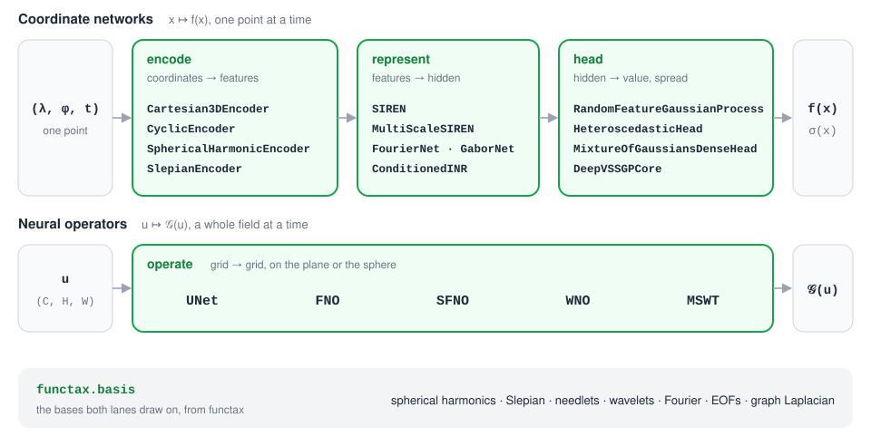
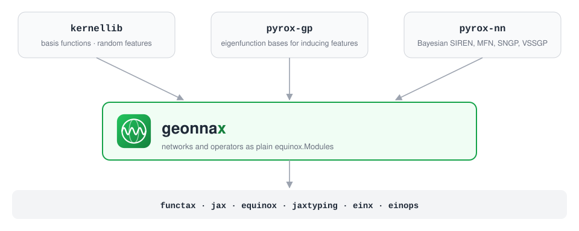
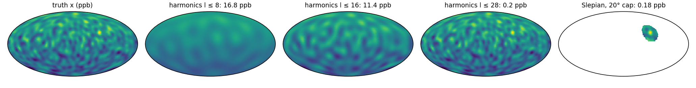
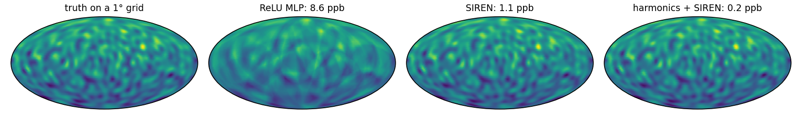
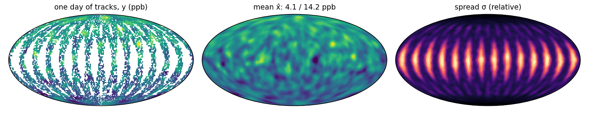

<p align="center">
  <picture>
    <source media="(prefers-color-scheme: dark)" srcset="docs/assets/logo-dark.svg">
    
  </picture>
</p>

<p align="center">
  <a href="https://github.com/jejjohnson/geonnax/actions/workflows/ci.yml"></a>
  <a href="https://github.com/jejjohnson/geonnax/actions/workflows/lint.yml"></a>
  <a href="https://github.com/jejjohnson/geonnax/actions/workflows/typecheck.yml"></a>
  <a href="https://codecov.io/gh/jejjohnson/geonnax"></a>
  
  <a href="https://opensource.org/licenses/MIT"></a>
</p>

<p align="center">
  <a href="https://jejjohnson.github.io/geonnax/"><b>Docs</b></a> ·
  <a href="https://jejjohnson.github.io/geonnax/api/"><b>API</b></a> ·
  <a href="https://jejjohnson.github.io/geonnax/#quickstart"><b>Quickstart</b></a> ·
  <a href="https://jejjohnson.github.io/geonnax/guides/methane/"><b>Example</b></a> ·
  <a href="#gallery"><b>Gallery</b></a>
</p>

**Networks, neural operators and basis functions for fields on the plane and the sphere, in pure Equinox.**

geonnax has two families of models.
Coordinate networks take one point, a longitude and latitude (and a time, if you have one), and return the field's value there: an encoder turns the point into features, a representation network such as a SIREN maps those to a value, and an optional head adds a per-point spread.
Neural operators (U-Net, FNO, spherical FNO, wavelet operators) take a whole gridded field and return another.
Both take their bases (spherical harmonics, Slepian functions, needlets, wavelets, Fourier modes, EOFs and graph-Laplacian eigenvectors) from [functax](https://github.com/jejjohnson/functax).

Every model is a plain `equinox.Module` with an `init(..., *, key)` constructor, acting on one example, so `jit`, `vmap` and `grad` work as usual.
Nothing in it is probabilistic: [pyrox](https://github.com/jejjohnson/pyrox) wraps these cores and swaps their parameters for NumPyro sites.

<p align="center">
  <picture>
    <source media="(prefers-color-scheme: dark)" srcset="docs/assets/hero-dark.svg">
    
  </picture>
</p>

## Installation

geonnax is not on PyPI yet; install it from GitHub with [uv](https://docs.astral.sh/uv/):

```bash
uv add "geonnax @ git+https://github.com/jejjohnson/geonnax.git"
```

It depends on jax, equinox, jaxtyping, einx, einops and [functax](https://github.com/jejjohnson/functax), which holds the bases, sphere grids, field derivatives and transforms that geonnax's networks are built on.
Training loops are yours to write; the [methane example](https://jejjohnson.github.io/geonnax/guides/methane/) uses [optax](https://github.com/google-deepmind/optax) (`uv add optax`).

## What's inside

Each family links to its API page; [`docs/api/capabilities.md`](docs/api/capabilities.md) lists every public name.

| Family | Module | Names |
|---|---|---|
| [Coordinate encoders](https://jejjohnson.github.io/geonnax/api/encoders/) | `encoders`, `slepian`, `geo` | `Cartesian3DEncoder`, `CyclicEncoder`, `SphericalHarmonicEncoder`, `SlepianEncoder`, `HybridSphericalSlepianEncoder`, `GeoContextEncoder`, `LonLatScale`, `Deg2Rad`; lon/lat helpers in `geo` |
| [Representation networks](https://jejjohnson.github.io/geonnax/api/representation/) | `siren`, `multi_scale_siren`, `mfn` | `SIREN`, `SirenDense`, `MultiScaleSIREN`, `FourierNet`, `GaborNet` |
| [Conditioning](https://jejjohnson.github.io/geonnax/api/uncertainty/#conditioning-hypernetworks) | `conditioning` | `FiLM`, `ConcatConditioner`, `AffineModulation`, `HyperLinear`, `HyperSIREN`, `GeneratedSiren`, `ConditionedINR` |
| [Uncertainty heads](https://jejjohnson.github.io/geonnax/api/uncertainty/) | `randfeat`, `sngp`, `vssgp`, `spectral_norm`, `ensemble`, `heteroscedastic`, `mixture`, `crf`, `ncp` | `OrthogonalRandomFeatures`, `RandomFeatureGaussianProcess`, `DeepVSSGPCore`, `SpectralNormalization`, `LayerNormEnsemble`, `MultiHeadAttentionBE`, `HeteroscedasticHead`, `MixtureOfGaussiansDenseHead`, `LinearChainCRF`, `NCPContinuousPerturb` |
| [Neural operators](https://jejjohnson.github.io/geonnax/api/operators/) | `fno`, `sfno`, `wno`, `mswt`, `manifold_no` | `FNO` (dense, CP, Tucker or TT spectral weights), `SFNO`, `WNO`, `MSWT`, `ManifoldNO` |
| [U-Nets](https://jejjohnson.github.io/geonnax/api/unet/) | `unet` | `UNet`, `XUNet`, `NestedResidualUNet` (U²-Net stages), 1-D, 2-D or 3-D |
| [Building blocks](https://jejjohnson.github.io/geonnax/api/layers/) | `layers` | `StandardizedConv`, `ResnetBlock`, `ConvNeXtBlock`, `Attention`, `SpectralConv`, `SphericalSpectralConv`, `WaveletConv`, `SphericalWaveletConv`, `WaveletAttention`, `Downsample`, `Upsample`, … |
| [Bases](https://jejjohnson.github.io/geonnax/api/bases/) | `basis` | `interaction_features`, `standardize`; the bases and sphere grids moved to `functax.basis` and `functax.geometry` |

Every module acts on one example, channels first: a 2-D field is `(channels, height, width)` and a coordinate is `(2,)`.
Use `jax.vmap` for a batch.

## Where it sits

<p align="center">
  <picture>
    <source media="(prefers-color-scheme: dark)" srcset="docs/assets/layers-dark.svg">
    
  </picture>
</p>

geonnax sits near the bottom of the stack and imports only functax from it.
[pyrox-nn](https://github.com/jejjohnson/pyrox) wraps its SIREN, MFN, SNGP and VSSGP cores as Bayesian layers; [kernellib](https://github.com/jejjohnson/kernellib) and [pyrox-gp](https://github.com/jejjohnson/pyrox) take their bases from functax.
That is why parameter names here are stable: pyrox addresses them by name.

## Gallery

The three stages of a coordinate network on the [methane example](https://jejjohnson.github.io/geonnax/guides/methane/), drawn by [`docs/assets/readme/figures.py`](docs/assets/readme/figures.py) from the example's own code.
The basis gallery (spherical harmonics, Slepian functions, needlets) is in [functax's README](https://github.com/jejjohnson/functax#gallery).

Encode: least-squares fits with spherical harmonics up to degree 8, 16 and 28, and a Slepian fit inside a 20° cap.

<p align="center"></p>

Represent: a ReLU MLP, a SIREN, and spherical harmonics feeding a SIREN, each trained on a 2° grid and read on a 1° grid.

<p align="center"></p>

Head: one day of track observations, a GP head's mean map, and its spread, low along the tracks and high in the gaps between them.

<p align="center"></p>

## Related projects

| Project | Role |
|---|---|
| [gaussx](https://github.com/jejjohnson/gaussx) | Structured linear algebra, solvers, Gaussian primitives |
| [functax](https://github.com/jejjohnson/functax) | Function approximation: the bases, sphere grids, derivatives and transforms geonnax builds on |
| [kernellib](https://github.com/jejjohnson/kernellib) | Kernels and scalable kernel methods, on functax's bases and random features |
| [pyrox](https://github.com/jejjohnson/pyrox) | Equinox–NumPyro bridge; Bayesian layers (`pyrox-nn`) over geonnax cores, GP models (`pyrox-gp`) |

## Development

```bash
git clone https://github.com/jejjohnson/geonnax.git
cd geonnax
make install      # all dependency groups + pre-commit hooks
make test-fast    # the fast tier, what CI runs
make lint         # ruff check .  (entire repo)
make typecheck    # ty check src/geonnax
make docs-serve   # preview the docs locally
```

Before committing, all four gates must pass: tests, `ruff check .`, `ruff format --check .` and `ty check src/geonnax`.
See [`CONTRIBUTING.md`](CONTRIBUTING.md) and [`AGENTS.md`](AGENTS.md) for the workflow, coding conventions and the issue and epic model.
The icon and diagrams are generated by [`docs/assets/render.py`](docs/assets/render.py) (`uv run --no-project python docs/assets/render.py`), and the figures by [`docs/assets/readme/figures.py`](docs/assets/readme/figures.py), which runs the code blocks of the [methane example](https://jejjohnson.github.io/geonnax/guides/methane/) as written.

## License

MIT, see [LICENSE](LICENSE).
