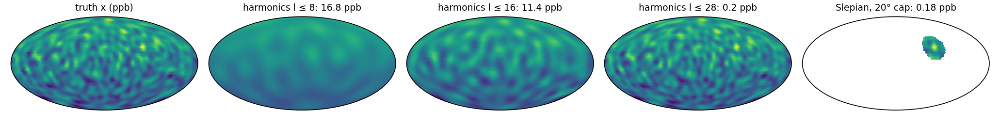
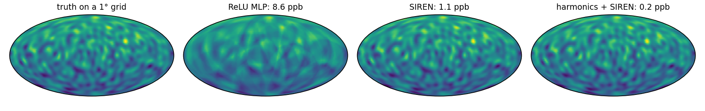
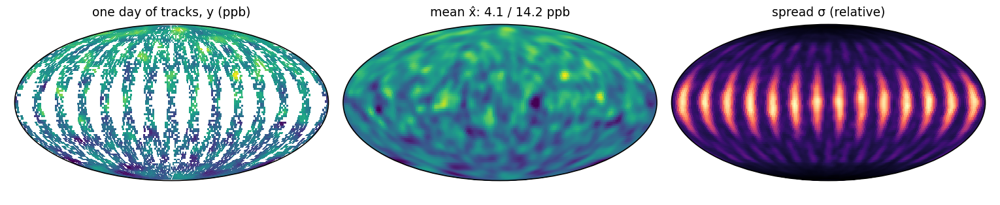

# Map methane around the globe

The GeoML stack's running example is one methane overpass: [kernellib](https://github.com/jejjohnson/kernellib#example-map-methane-from-one-overpass) and [pyrox](https://github.com/jejjohnson/pyrox#example-map-methane-from-one-overpass) map XCH₄ over a 100 × 100 grid in the Permian Basin.
geonnax's encoders and operators earn their keep on the sphere, so here the same quantity is mapped over the whole globe from one day of satellite tracks.

The state x is column-averaged methane, XCH₄, in ppb on a 2° grid, so N = 16,200 cells.
A sun-synchronous satellite crosses the globe on 14 tracks a day, each 8° wide, and clouds hide 30 % of what it passes over; that leaves O = 7,921 observed cells, each with noise of σ_obs = 6 ppb.
The block below simulates the day: a background with a north–south gradient, six regional sources and synoptic variability up to degree 28.
A real L2 product's pixels drop in for `lonlat`, `mask` and `y`.

```python
import einx
import equinox as eqx
import geonnax as gnx
import jax
import jax.numpy as jnp
import jax.random as jr
import optax
from functax.basis.slepian import slepian_cap_basis
from functax.basis.sphere import real_spherical_harmonics
from functax.geometry import lonlat_to_unit
from jaxtyping import Array, Bool, Float


# Shapes: N = 90 × 180 cells of a 2° grid, M = (l_max + 1)² harmonics,
#         S = 6 sources, T = 14 tracks, O = Σᵢ maskᵢ observed cells
lon, lat = jnp.meshgrid(jnp.linspace(-179.0, 179.0, 180), jnp.linspace(-89.0, 89.0, 90))
lonlat: Float[Array, "N 2"] = jnp.deg2rad(einx.id("h w, h w -> (h w) (1 + 1)", lon, lat))
# u(λ, φ) = (cos φ cos λ, cos φ sin λ, sin φ), the point on the unit sphere
u: Float[Array, "N 3"] = lonlat_to_unit(lonlat)  # (N, 2) → (N, 3)  functax

# Sources: centre (λ, φ in °), width wₛ (°), amplitude aₛ (ppb)
src = jnp.array([[78, 25, 8, 45], [112, 32, 7, 40], [-95, 32, 5, 30],
                 [25, 5, 10, 30], [-60, -5, 9, 25], [45, 60, 6, 20]], dtype=float)
c_s: Float[Array, "S 3"] = lonlat_to_unit(jnp.deg2rad(src[:, :2]))  # (S, 3)
# ξ = Σ_{8 ≤ l ≤ 28} Σₘ βₗₘ Yₗᵐ,  βₗₘ ~ 𝒩(0, (40 / l)²): synoptic variability
deg = jnp.concatenate([jnp.full(2 * l + 1, l) for l in range(29)])  # (M,)  l of each Yₗᵐ
beta = jnp.where(deg >= 8, 40.0 / jnp.maximum(deg, 1), 0.0) * jr.normal(jr.key(0), deg.shape)


# x(u) = 1880 + 25 u_z + Σₛ aₛ exp(−(1 − ⟨u, cₛ⟩) / (1 − cos wₛ)) + ξ(u),  ppb
def xch4(u: Float[Array, "P 3"]) -> Float[Array, " P"]:
    cos_d = einx.dot("p d, s d -> p s", u, c_s)            # (P, 3), (S, 3) → (P, S)
    width = 1.0 - jnp.cos(jnp.deg2rad(src[:, 2]))          # (S,)
    plumes = einx.dot("p s, s -> p", jnp.exp(-(1.0 - cos_d) / width), src[:, 3])  # (P,)
    xi = real_spherical_harmonics(u, 28) @ beta  # (P, 3) → (P, M) → (P,)
    return 1880.0 + 25.0 * u[:, 2] + plumes + xi           # (P,)  ppb


x: Float[Array, " N"] = xch4(u)                            # (N,)  ppb, the truth

# One day of tracks: T great circles inclined 98°, 8° wide, 70 % cloud-free
inc, node = jnp.deg2rad(98.0), jnp.deg2rad(jnp.arange(14) * 360.0 / 14)
n_t: Float[Array, "T 3"] = einx.id("t, t, -> t (1 + 1 + 1)", jnp.sin(inc) * jnp.sin(node),
                                  -jnp.sin(inc) * jnp.cos(node), jnp.cos(inc))  # orbit normals
# θᵢ = minₜ |asin ⟨uᵢ, nₜ⟩|, the angular distance to the nearest track
cos_t: Float[Array, "N T"] = einx.dot("n d, t d -> n t", u, n_t)  # (N, 3), (T, 3) → (N, T)
theta: Float[Array, " N"] = einx.min("n [t]", jnp.abs(jnp.arcsin(cos_t)))  # (N, T) → (N,)
k_cloud, k_noise = jr.split(jr.key(1))
mask: Bool[Array, " N"] = (theta < jnp.deg2rad(4.0)) & jr.bernoulli(k_cloud, 0.7, theta.shape)
# yᵢ = xᵢ + εᵢ,  εᵢ ~ 𝒩(0, 6²) ppb, kept where observed
y: Float[Array, " O"] = (x + 6.0 * jr.normal(k_noise, x.shape))[mask]  # (N,) → (O,)
```

## Stage 1: encode, or what a feature map can express (geonnax.encoders, geonnax.slepian)

**TL;DR.** An encoder fixes the finest scale a coordinate network can resolve. Spherical harmonics cover the globe; Slepian functions spend the same band limit on one region.

**Problem.** An encoder maps a point to M features z(u) ∈ ℝᴹ.
For the spherical harmonics up to degree L, M = (L + 1)², and the best map they can express is the least-squares fit

$$\hat\beta = \arg\min_\beta \lVert Z\beta - x \rVert^2$$

with Z ∈ ℝ^{N×M} holding the features of every cell,

$$Z_{im} = Y_\ell^m(u_i)$$

Degree ℓ resolves features down to about 180°/ℓ, so the band limit L is a resolution.
For a region R, the Slepian functions are the band-limited functions g that put the most energy inside R.
They solve

$$\lambda = \max_g \frac{\int_R g^2 \, d\Omega}{\int_{S^2} g^2 \, d\Omega}$$

and about (L + 1)² · |R| / 4π of them have λ close to 1.

```python
# zₘ(u) = Yₗᵐ(u),  m = 1, …, (L + 1)²: global and orthonormal on S²
def sh_fit(l_max: int) -> Float[Array, ""]:
    enc = gnx.SphericalHarmonicEncoder(l_max, input_mode="lonlat")  # (2,) → (M,)  geonnax
    Z: Float[Array, "N M"] = jax.vmap(enc)(lonlat)         # (N, 2) → (N, M)
    # β̂ = argmin_β ‖Zβ − x‖², the best map the encoder can express
    beta_hat = jnp.linalg.lstsq(Z, x)[0]                   # (N, M), (N,) → (M,)
    return jnp.sqrt(jnp.mean((Z @ beta_hat - x) ** 2))     # (N,) → ()  RMSE, ppb


rmse_sh = {l_max: float(sh_fit(l_max)) for l_max in (8, 16, 28)}

# gₖ = argmax_g ∫_R g² / ∫_S² g²,  band-limited to l ≤ 28,  R a 20° cap over South Asia
c_R = jnp.deg2rad(jnp.array([78.0, 25.0]))                 # cap centre (λ, φ), rad
cap = slepian_cap_basis(28, jnp.deg2rad(20.0), n_modes=60, lonlat_centre=c_R)
G: Float[Array, "N K"] = jax.vmap(gnx.SlepianEncoder(cap))(lonlat)  # (N, 2) → (N, K)  geonnax
u_R = lonlat_to_unit(c_R)  # (3,)
in_R: Bool[Array, " N"] = jnp.arccos(u @ u_R) < jnp.deg2rad(20.0)  # (N,)  inside the cap
# a = x − x̄_R inside R, fitted with K = 60 functions instead of M = 841
a_R = x[in_R] - jnp.mean(x[in_R])                          # (N,) → (R,)
gamma = jnp.linalg.lstsq(G[in_R], a_R)[0]                  # (R, K), (R,) → (K,)
rmse_cap = float(jnp.sqrt(jnp.mean((G[in_R] @ gamma - a_R) ** 2)))  # ppb
```

Harmonics to degree 8 and 16 miss the synoptic variability and leave 16.8 and 11.4 ppb RMS; degree 28, the field's own band limit, gets to 0.20 ppb.
Inside the cap, K = 60 Slepian functions fit the anomaly to 0.18 ppb, as well as all 841 harmonics do there, with 14 times fewer features.



## Stage 2: represent, or a field you can query anywhere (geonnax.siren)

**TL;DR.** Fit three coordinate networks of the same size to the gridded field, then score them between the grid cells they were trained on. The encoder decides who wins.

**Problem.** A coordinate network f_θ = represent ∘ encode is fitted to the N grid values by

$$\hat\theta = \arg\min_\theta \frac{1}{N} \sum_{i=1}^{N} \left( f_\theta(\lambda_i, \varphi_i) - t_i \right)^2$$

where tᵢ = (xᵢ − 1880) / 25 is the field scaled to order one.

A ReLU network learns low frequencies first and fine detail last, its spectral bias.
A SIREN uses sin(ω₀ W z + b) activations, which reach fine detail directly; an encoder can hand it features that already live on the sphere.
All three networks have width 128 and depth 3, and get the same 2,000 Adam steps.

```python
# f(λ, φ) = represent(encode(λ, φ)): one point in, one value out
class CoordNet(eqx.Module):
    encode: eqx.Module
    represent: eqx.Module

    def __call__(self, ll: Float[Array, " 2"]) -> Float[Array, ""]:
        return self.represent(self.encode(ll))[0]          # (2,) → (D,) → (1,) → ()


# θ̂ = argmin_θ (1/P) Σᵢ (f_θ(λᵢ, φᵢ) − tᵢ)²,  by full-batch Adam
def fit(model: eqx.Module, ll: Float[Array, "P 2"], t: Float[Array, " P"],
        steps: int = 2000, lr: float = 1e-3) -> eqx.Module:
    opt = optax.adam(lr)
    state = opt.init(eqx.filter(model, eqx.is_inexact_array))

    @eqx.filter_jit
    def step(model, state):
        loss = lambda m: jnp.mean((jax.vmap(m)(ll) - t) ** 2)  # (P, 2) → (P,) → ()
        grads = eqx.filter_grad(loss)(model)
        updates, state = opt.update(grads, state, model)
        return eqx.apply_updates(model, updates), state

    for _ in range(steps):
        model, state = step(model, state)
    return model


keys = jr.split(jr.key(2), 3)
models = {
    # u = (cos φ cos λ, cos φ sin λ, sin φ) → ReLU MLP
    "ReLU MLP": CoordNet(gnx.Cartesian3DEncoder(), eqx.nn.MLP(3, 1, 128, 3, key=keys[0])),
    # u → W₄ sin(ω ⋯ sin(ω₀ W₁ u + b₁) ⋯) + b₄
    "SIREN": CoordNet(gnx.Cartesian3DEncoder(), gnx.SIREN.init(3, 128, 1, depth=3, key=keys[1])),
    # z = [Yₗᵐ(λ, φ)]_{l ≤ 10} → SIREN
    "harmonics + SIREN": CoordNet(gnx.SphericalHarmonicEncoder(10, input_mode="lonlat"),
                                  gnx.SIREN.init(121, 128, 1, depth=3, key=keys[2],
                                                 first_omega=10.0)),
}
fits = {name: fit(m, lonlat, (x - 1880.0) / 25.0) for name, m in models.items()}

# Score between the training cells: Q = 180 × 360 cell centres of a 1° grid
lon1, lat1 = jnp.meshgrid(jnp.linspace(-179.5, 179.5, 360), jnp.linspace(-89.5, 89.5, 180))
lonlat1: Float[Array, "Q 2"] = jnp.deg2rad(einx.id("h w, h w -> (h w) (1 + 1)", lon1, lat1))
x1: Float[Array, " Q"] = xch4(lonlat_to_unit(lonlat1))  # (Q,)  ppb
rmse_net = {name: float(jnp.sqrt(jnp.mean((1880.0 + 25.0 * jax.vmap(f)(lonlat1) - x1) ** 2)))
            for name, f in fits.items()}                   # ppb, off the training grid
```

Scored on the 1° grid, between the cells they were trained on, the ReLU MLP is 8.6 ppb RMS from the truth and blurs the synoptic structure.
The SIREN gets to 1.1 ppb, and the SIREN fed spherical harmonics to 0.16 ppb.
Width, depth and training are the same for all three, so the gap is spectral bias and the encoder: the harmonics hand the SIREN features that already live on the sphere.



## Stage 3: head, or a map from one day of tracks and its spread (geonnax.sngp)

**TL;DR.** Map the field from the tracked cells alone, and attach a spread that says where the map is guessing.

**Problem.** The head is a random-feature Gaussian process (SNGP).
D random Fourier features of the encoder's output, φ(z) = √(2/D) cos(Wz/ℓ + b), feed a linear readout μ(z) = φ(z)ᵀh.
The readout and the lengthscale ℓ are trained; W and b stay fixed.
A Laplace approximation over h gives the spread

$$\sigma^2(z) = \phi(z)^\top \hat\Sigma \, \phi(z)$$

$$\hat\Sigma = \left( \frac{\Phi^\top \Phi}{O} + \rho I \right)^{-1}$$

where Φ ∈ ℝ^{O×D} stacks the features of the O observed cells and ρ is a ridge.
σ is small near the data and grows away from it, so it is a relative measure: it ranks where the map can be trusted rather than giving error bars in ppb.

```python
# φ(z) = √(2/D) cos(W z / ℓ + b),  μ(z) = φ(z)ᵀ h,  D = 1,024 features on l ≤ 12 harmonics
head = gnx.RandomFeatureGaussianProcess.init(169, 1024, 1, key=jr.key(3), init_lengthscale=3.0,
                                             momentum=0.0, ridge=1e-5)
gp = CoordNet(gnx.SphericalHarmonicEncoder(12, input_mode="lonlat"), head)  # (2,) → (169,) → ()
gp = fit(gp, lonlat[mask], (y - 1880.0) / 25.0, lr=1e-2)  # μ from the O observed cells only

# Σ̂ = (ΦᵀΦ / O + ρ I)⁻¹,  Φ the features at the observed cells
Z_obs: Float[Array, "O 169"] = jax.vmap(gp.encode)(lonlat[mask])        # (O, 2) → (O, 169)
Phi: Float[Array, "O D"] = jax.vmap(gp.represent.feature_map)(Z_obs)  # (O, 169) → (O, D)
gp = eqx.tree_at(lambda m: m.represent, gp, gp.represent.update_precision(Phi))

# μ(z), σ²(z) = φ(z)ᵀ Σ̂ φ(z) on all N cells
mu, var = jax.vmap(lambda ll: gp.represent(gp.encode(ll), return_cov=True))(lonlat)
x_hat: Float[Array, " N"] = 1880.0 + 25.0 * mu[:, 0]      # (N, 1) → (N,)  ppb
sigma: Float[Array, " N"] = jnp.sqrt(var)                  # (N,)  relative spread
err = x_hat - x
rmse_gp = {"observed": float(jnp.sqrt(jnp.mean(err[mask] ** 2))),
           "unobserved": float(jnp.sqrt(jnp.mean(err[~mask] ** 2)))}  # ppb
sigma_ratio = float(jnp.mean(sigma[~mask]) / jnp.mean(sigma[mask]))
```

On the observed cells the mean is 4.1 ppb RMS from the truth, below the 6 ppb pixel noise.
On the unobserved cells, mostly the gaps between tracks, it is 14.2 ppb, because synoptic features narrower than a gap are never seen.
σ says so: on average it is 1.7 times higher off the tracks than on them, it peaks in the equatorial gaps, and it falls towards the poles, where the tracks converge.
The whole example runs in about 12 minutes on a CPU; [`docs/assets/readme/figures.py`](https://github.com/jejjohnson/geonnax/blob/main/docs/assets/readme/figures.py) runs its blocks as written and draws the three figures.


